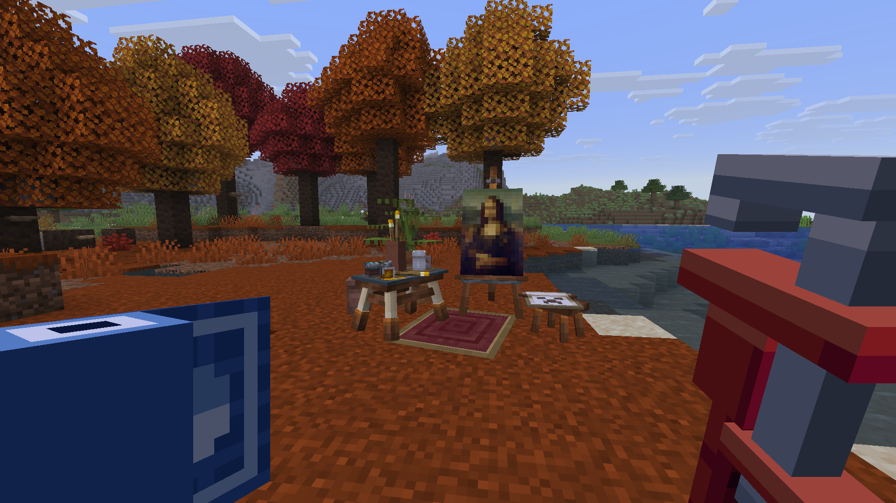
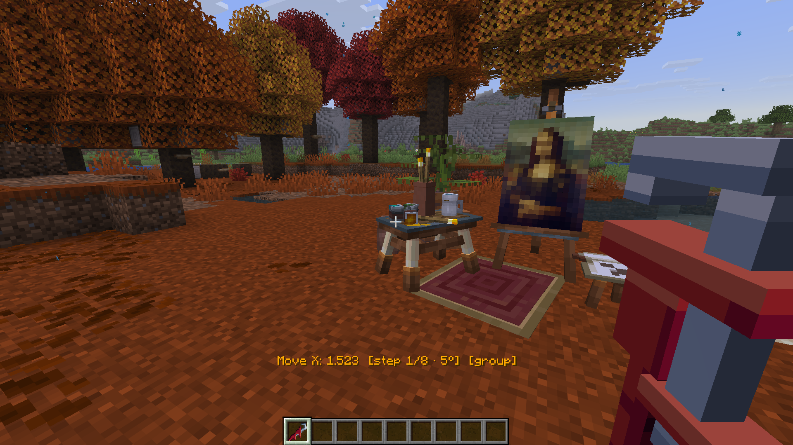
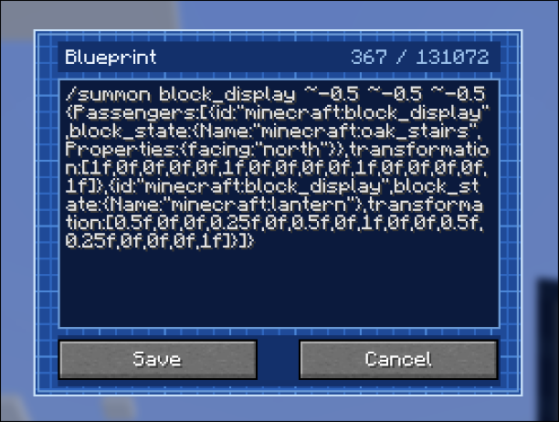
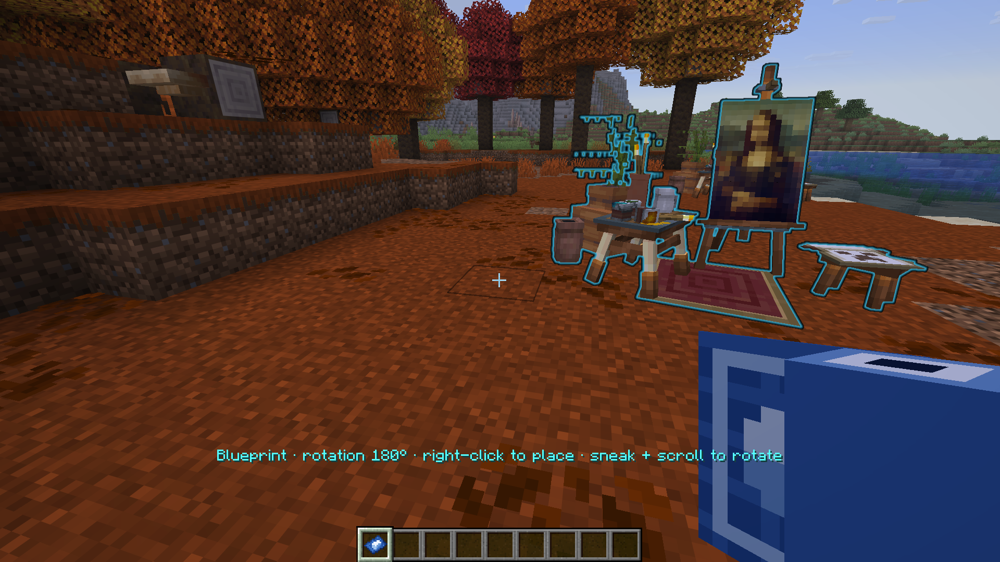
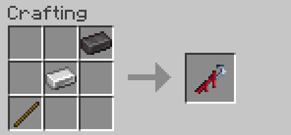
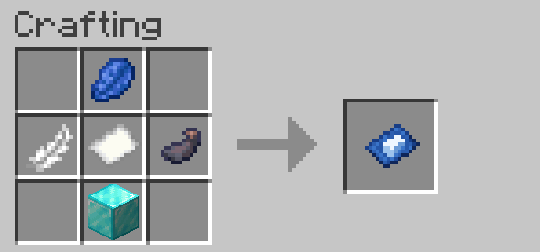

<div align="center">

# Wrench Display

**Build with block, item and text displays in survival, with no commands.**

A wrench to place and fine-tune displays, and a blueprint that turns a pasted `/summon` model into a real build.
Runs on the server only: vanilla players can join and use everything.

[Modrinth](https://modrinth.com/project/wrench-display) · Fabric 1.21.6 – 26.3 · Paper, Purpur and Folia 1.21.6 – 26.3



</div>

## The wrench

Hold a block or item in your **off hand** and right-click a block with the wrench: it is placed as a block or
item display. Stairs face away from you, slabs and logs follow the face you click, just like normal placing.

Then **look at any display** and edit it:

| Input | Does |
|---|---|
| Right-click / left-click | raise / lower the selected property |
| Sneak + scroll, or sneak + right/left-click | pick the next / previous property |

The action bar shows what you are editing, and the display you are aiming at is outlined.



The properties:

- **Move X / Y / Z**, **Rotate yaw / pitch / roll**, **Scale** (whole or per axis)
- **Step**: how far one click goes, from 1 block down to 1/16, and 90° down to 1°
- **Block state** and **State value**: turn stairs, open trapdoors, light candles…
- **Item pose** (how an item display is held), **Billboard**, **Shadow radius / strength**
- **Block light**, **Sky light**, **Glow**, **Glow colour**, **View range** (operators by default)
- **Mode**: displays placed from one blueprint form a group and move together; switch to single parts here
- **Remove**: takes the display down and gives its item back

Example: make a tilted lantern on a post. Place a fence with the wrench, then a lantern above it, select
**Move Y** with step 1/8 and lower the lantern onto the fence, then **Rotate roll** a few clicks.

## The blueprint

Right-click the air with a blank blueprint and paste a `/summon` command for block, item and text displays, like
the ones display-model websites export. The model is checked and stored on the server, and the blueprint shows what
it is made of.



Hold the filled blueprint and a **ghost of the model** follows where you look. Sneak + scroll turns it in 90° steps,
right-click places it. In survival, placing costs the blocks and items the model is made of; anything missing is
listed in chat. A placed model can be edited with the wrench like any other display.



A small model to try:

```
/summon block_display ~-0.5 ~-0.5 ~-0.5 {Passengers:[{id:"minecraft:block_display",block_state:{Name:"minecraft:oak_stairs",Properties:{facing:"north"}},transformation:[1f,0f,0f,0f,0f,1f,0f,0f,0f,0f,1f,0f,0f,0f,0f,1f]},{id:"minecraft:block_display",block_state:{Name:"minecraft:lantern"},transformation:[0.5f,0f,0f,0.25f,0f,0.5f,0f,1f,0f,0f,0.5f,0.25f,0f,0f,0f,1f]}]}
```

Vanilla clients paste in a vanilla window, which holds up to about 16 000 characters (the most the game's protocol
carries). Bigger models, and most exported ones are bigger, need the mod on the client: it opens its own paste screen
that takes up to 131 072 characters, on Fabric and on Paper servers.

## Crafting

Or give the tools with `/wrenchdisplay give <players> wrench|blueprint`.

<table>
<tr><th>Wrench</th><th>Blueprint</th></tr>
<tr>
<td></td>
<td></td>
</tr>
<tr>
<td>netherite ingot top right, iron ingot in the middle, stick bottom left</td>
<td>lapis lazuli on top; feather, paper, ink sac in the middle; diamond block below</td>
</tr>
</table>

The tools are a stick and a paper underneath, but they can't be crafted with, burned, traded or used in a
cartography table as one.

## Fair in survival

Players without extra permissions get limits that keep displays from becoming a building cheat:

- placing uses up the item, and removing gives it back
- a display moves at most **1 block** from where it was placed and scales between **0.25×** and **2×**
- at most **64** wrench displays per chunk
- blueprints up to **5 × 5 × 5** blocks and **256** parts, with no single part over 3 blocks
- only common block-state keys (facing, half, open, lit, …) and no technical blocks (barrier, light, portals,
  command blocks, …)
- glow, light level and view range are for operators
- players only edit their own displays

Every limit has a permission to lift it, and all numbers are in the config.

## Installing

### Fabric server

1. Put `wrench-display-fabric-<version>+<minecraft>.jar` for your Minecraft version and
   [Fabric API](https://modrinth.com/mod/fabric-api) in the `mods` folder. There are jars for 1.21.6–1.21.8,
   1.21.9–1.21.10, 1.21.11, 26.1–26.1.2, 26.2 and 26.3.
2. Send the resource pack to players (see below).
3. Optional: players who install the same jar on their client get the big paste screen and don't need the pack.

Claim mods that support [Common Protection API](https://github.com/Patbox/common-protection-api) are respected.

### Paper server

1. Put `wrench-display-paper-<version>.jar` in the `plugins` folder. One jar works on Paper, Purpur and Folia
   1.21.6 – 26.3. On 1.21.6 the vanilla paste window is missing (Paper's dialog API starts at 1.21.7); the client
   mod's paste screen still works there.
2. Send the resource pack to players (see below).

Claim plugins (WorldGuard, GriefPrevention, Lands, Towny, …) are respected: placing, editing and removing a display
is checked as building at that spot.

### The resource pack

Vanilla clients need `wrench-display-pack-<version>.zip` to see the wrench and blueprint models; it works on every
supported version. Host it somewhere public and either set `resource-pack` and `resource-pack-sha1` in
`server.properties`, or let the mod send it:

```json
"resourcePack": {
  "url": "https://example.com/wrench-display-pack-1.1.zip",
  "sha1": "the hash from wrench-display-pack-1.1.zip.sha1",
  "required": false,
  "prompt": "Wrench Display textures"
}
```

## Configuration

`config/wrench-display.json` on Fabric, `plugins/WrenchDisplay/config.json` on Paper. Missing keys are filled in with
defaults; `/wrenchdisplay reload` applies changes.

```json
{
  "wrench": { "reach": 5.0 },
  "survival": {
    "maxOffset": 1.0,
    "minScale": 0.25,
    "maxScale": 2.0,
    "maxDisplaysPerChunk": 64,
    "allowedBlockStateKeys": ["facing", "axis", "half", "..."],
    "restrictedBlocks": ["minecraft:barrier", "minecraft:light", "..."]
  },
  "blueprint": {
    "maxLength": 131072,
    "vanillaMaxLength": 16000,
    "maxParts": 256,
    "maxPartsWithBypass": 2048,
    "maxModelSize": 5.0,
    "maxPartSize": 3.0
  }
}
```

## Permissions

Without a permission mod, everyone may use the tools and operators (level 2) get everything else.
With one (e.g. LuckPerms), the nodes are below as used on Fabric 26.x. On Paper and on Fabric 1.21.x they are
written with dots instead of the colon (`wrenchdisplay.use.wrench`); the defaults are the same everywhere.

| Node | Allows |
|---|---|
| `wrenchdisplay:use.wrench`, `wrenchdisplay:use.blueprint` | using the tools (default: everyone) |
| `wrenchdisplay:bypass.offset` | moving displays more than `maxOffset` from where they were placed |
| `wrenchdisplay:bypass.scale` | scales outside `minScale`–`maxScale` |
| `wrenchdisplay:bypass.chunklimit` | more than `maxDisplaysPerChunk` displays per chunk |
| `wrenchdisplay:bypass.cost` | placing without using up items |
| `wrenchdisplay:bypass.blueprintsize` | blueprints larger than `maxModelSize` / `maxPartSize` |
| `wrenchdisplay:visual` | glow, glow colour, brightness, view range |
| `wrenchdisplay:blocks.restricted` | restricted blocks (barrier, light, portals, command blocks, …) |
| `wrenchdisplay:blockstate.free` | block-state keys outside the survival list |
| `wrenchdisplay:text` | text displays in blueprints |
| `wrenchdisplay:edit.others` | editing displays someone else placed |
| `wrenchdisplay:edit.foreign` | editing displays not placed with the wrench |
| `wrenchdisplay:admin` | `/wrenchdisplay` |

## Translations

All text players see is translatable: `common/src/main/resources/assets/wrench-display/lang/en_us.json` holds the
English strings (wrench properties, block-state names and values, messages). Add a file for another language
(e.g. `uk_ua.json`) with the same keys. Players get translations through the resource pack or the client mod;
without either they see English. Block, item and colour names always use the game's own translations.

## Building

```
./gradlew build                        # mod jars (one per Minecraft version), plugin jar, common library, resource pack zip
./gradlew runGameTest                  # in-game tests for every Fabric version, one after another
./gradlew :fabric:26.3:runClient       # play-test one Fabric version
./gradlew :fabric:1.21.8:prodServer    # start a real Fabric server with that version's release jar
./gradlew :paper:runServer             # play-test Paper (-PpaperVersion=1.21.8 for another version); :paper:runFolia for Folia
```

The Fabric mod uses [Stonecutter](https://stonecutter.kikugie.dev) for several Minecraft versions from one source
tree. Versions and their settings are in `fabric/stonecutter.properties.toml`; code that differs between versions is
marked with `//? if` comments. Run `./gradlew "Set active project to <version>"` to work on another version and
`./gradlew "Reset active project"` before committing.

Releases: push a tag like `v1.1` (matching `version` in `gradle.properties`, with a `## 1.1` section in
`CHANGELOG.md`). The release workflow builds, runs the game tests and uploads every jar and the resource pack to
Modrinth.

## License

Wrench Display is released under the [MIT License](LICENSE).
